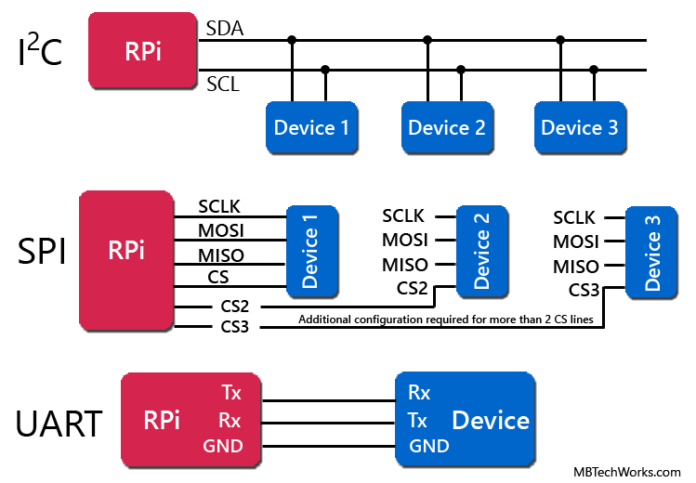
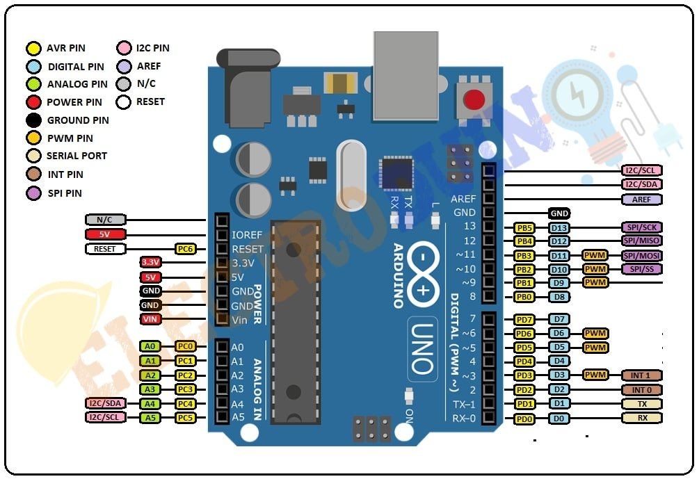
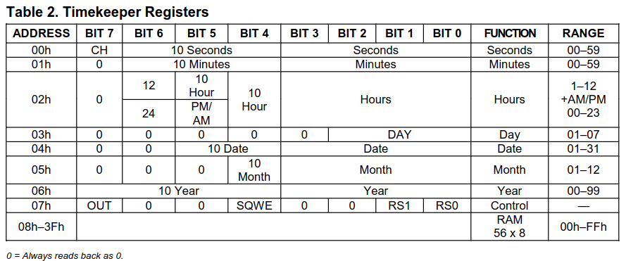

# Communication Interfaces


## Introduction

There are multiple interfaces to communicate with one or more devices, the most common are :
- UART: Universal Asynchronous Receiver/Transmitter
- SPI: Serial Peripheral Interface
- I2C: Inter-Integrated Circuit




## TODO

We'll use the website [Wokwi](wokwi.com) to simulate an Arduino. It is free to use and has many components to choose from.
You will 

### I2C

-  Start a project from scratch with an Arduino Uno
-  Add the following three components and connect them to the Arduino :
    -  DS1307, RTC Module
    -  MPU6050, 6-Axis Accel & Gyro Sensor
    -  BMP180, Barometric Pressure Sensor

    > The I2C pins can be found on the Arduino Uno Pinout :
    > 

-  Run a script to discover the addresses of the three components

    > Each component has a fixed address that can be found on their datasheet. But another method is to scan all addresses to find the connected devices.
    ><details>
    ><summary>[REVEAL CODE] Device scan</summary>
    >
    >```
    >#include <Wire.h>
    >
    >void setup() {
    >Serial.begin(9600);
    >Wire.begin();
    >
    >for (byte adresse = 1; adresse < 127; adresse++) {
    >
    >    Wire.beginTransmission(adresse);
    >
    >    byte erreur = Wire.endTransmission();
    >
    >    if (erreur == 0) {
    >    Serial.print("Peripherique trouve : 0x");
    >    Serial.println(adresse, HEX);
    >    }
    >}
    >}
    >
    >void loop() {
    >}
    >```
    >
    ></details>

    > Two devices cannot have the same address on the same bus. Unfortunately, both DS1307 and MPU6050 have the same one. Fortunately, the MPU6050 allows you to change its address whether AD0 is connected to GND or 5V.
    > 
    > Another solution is to use an I2C multiplexer such has the TCA9548A to connect more devices.

-  Change the address of MPU6050 and check whether you get three different addresses

-  Write a code to read and print the secondes from the DS1307 clock

    > Each I2C device has a register table, to read data from the device you need to ask it at the corresponding register adress.
    > 
    > For example here is the DS1307 register table from 0x00 to 0x07 :
    > 
    > 
    > The process to get data is :
    >- select device
    >- select register
    >- request a byte read
    >- read the byte
    > 
    > You can start from this example code and find the right register address :
    >
    > <details>
    > <summary>[REVEAL CODE] Read byte</summary>
    > 
    > ```
    > #include <Wire.h>
    > 
    > void setup() {
    > Serial.begin(9600);
    > Wire.begin();
    > }
    > 
    > void loop() {
    > 
    > // Select device and register
    > Wire.beginTransmission(0x68);
    > Wire.write(/*REGISTRE*/);   // A COMPLETER
    > Wire.endTransmission();
    > 
    > // Request a byte read
    > Wire.requestFrom(0x68, 1);
    > 
    > // Read the byte
    > if (Wire.available()) {
    > 
    >     byte seconds = Wire.read();
    > 
    >     // Convert BCD to décimal
    >     seconds = (seconds & 0x0F) + 10 * (seconds >> 4);
    > 
    >     Serial.print("Seconds : ");
    >     Serial.println(seconds);
    > }
    > 
    > delay(1000);
    > }
    > ```
    > 
    > </details>

- Write a code to read and print the x acceleration from the MPU6050
