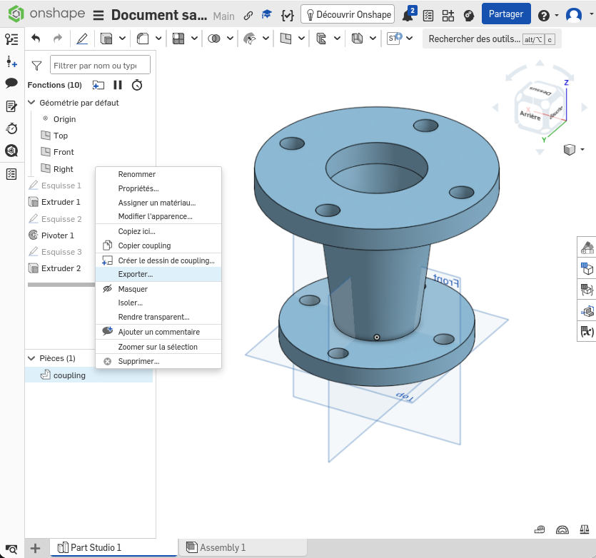
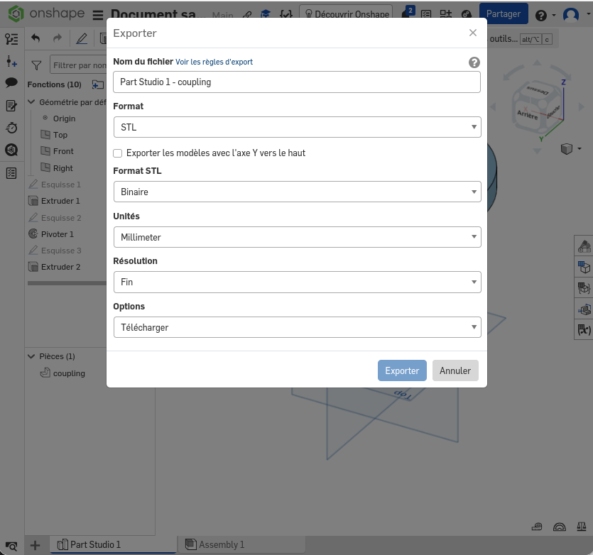
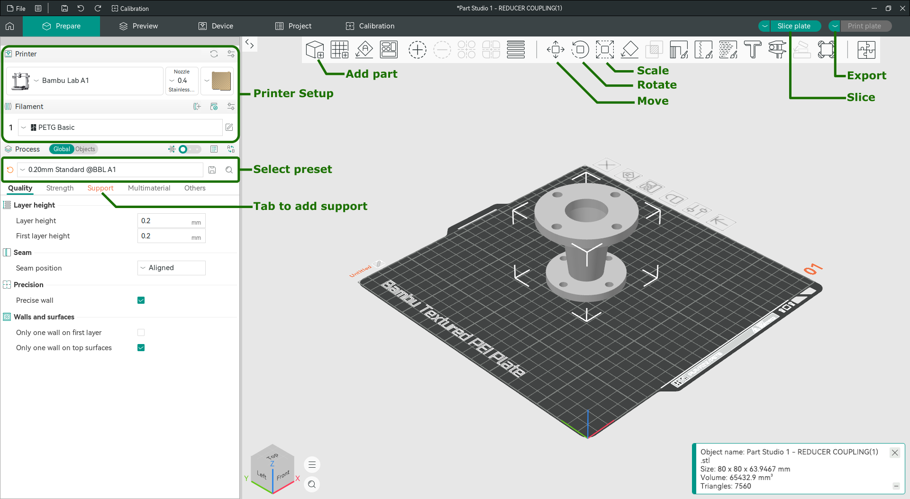

# CAO et fabrication FDM

## Conception

**Objectif:** Se familiariser avec un logiciel de CAO, voir les fonctionnalités essentielles

### Outils
Les logiciels de CAO (Conception Assistée par Ordinateur) les plus utilisés pour la conception mécanique sont les logiciels dit paramétriques. Le processus de design repose sur des esquisses précises et des opérations.

- [Onshape](https://www.onshape.com/)
    - licence gratuite étudiante
    - en ligne
    - facile à prendre en main
- [FreeCAD](https://www.freecad.org/downloads.php)
    - licence gratuite open source
    - Windows, Mac, Linux
    - légère courbe d'apprentissage
- [Autodesk Fusion](https://www.autodesk.com/education/edu-software/overview)
    - licence gratuite étudiante
    - Windows, Mac
    - facile à prendre en main  

### TODO

Pour cet atelier, nous allons utiliser le logiciel Onshape qui propose des exercices d'introduction à la modélisation paramétrique. [Créez un compte](https://www.onshape.com/en/education/sign-up) avec votre adresses @ensta.fr pour profiter de la licence étudiante.

Vous devrez compléter les exercices de la [formation Onshape](https://learn.onshape.com/learn/learning-path/introduction-to-cad) :
- Introduction to Sketching
    - ⭐ [Exercise: Basic Sketching](https://learn.onshape.com/learn/course/fundamentals-sketching/sketch-constraints/exercise-basic-sketching?page=1)
    - ⭐ [Exercise: Intermediate Skectching](https://learn.onshape.com/learn/course/fundamentals-sketching/sketch-tools/exercise-intermediate-sketching?page=1)
- Introduction to Part Studios
    - ⭐ [Exercise: Control Arm](https://learn.onshape.com/learn/course/introduction-to-part-studios/basic-features/exercise-control-arm?page=1)
    - ⭐ [Exercise: Reducer Coupling](https://learn.onshape.com/learn/course/introduction-to-part-studios/basic-features/exercise-reducer-coupling?page=1)
    - [Exercise: Jackhammer Gear Cover](https://learn.onshape.com/learn/course/introduction-to-part-studios/applied-features/exercise-jackhammer-gear-cover?page=1)
    - [Exercise: Funnel](https://learn.onshape.com/learn/course/introduction-to-part-studios/advanced-features/exercise-funnel?page=1)
    - [Exercise: Rocket Guidance Reflector](https://learn.onshape.com/learn/course/introduction-to-part-studios/patterning/exercise-rocket-guidance-reflector?page=1)
- Introduction to Onshape Assemblies
    - ⭐ [Exercise: Start an Assembly](https://learn.onshape.com/learn/course/introduction-to-onshape-assemblies/creating-an-assembly/exercise-start-an-assembly?page=1)
    - ⭐ [Exercise: Pneumatic Assembly](https://learn.onshape.com/learn/course/introduction-to-onshape-assemblies/mating-assembly-instances/exercise-pneumatic-cylinder?page=1)
    - [Exercise: Assembly Structure](https://learn.onshape.com/learn/course/introduction-to-onshape-assemblies/working-with-an-assembly/exercise-assembly-structure?page=1)
    - [Exercise: Creating Explicit Mate Connectors](https://learn.onshape.com/learn/course/introduction-to-onshape-assemblies/explicit-mate-connectors/exercise-creating-explicit-mate-connectors?page=1)

Les exercices marqués ⭐ sont à faire pour valider l'atelier, les autres sont intéressants pour apprendre de nouvelles techniques.

## Fabrication 

**Objectif:** Se familiariser avec l'impression 3D FDM, passer d'une pièce modélisé en CAO à une pièce physique

### Outils

Les imprimantes disponibles sont des Bambulab A1, pour les utiliser nous conseillons l'utilisation du logiciel [OrcaSlicer](https://www.orcaslicer.com/download/) disponible pour Windows, Mac et Linux.

### TODO
Imprimer la pièce modélisée, pour cela:

- Reprendre la pièce modélisée sur Onshape "Reducer Coupling"
- Exporter la pièce en format .STL en mm

  |  
:-------------------------:|:-------------------------:

- Ouvrir OrcaSlicer et le configurer:
    - Installer les plugins réseaux
    - Activer le Stealth Mode
    - Sélectionner Bambulab A1
    - Sélectionner les filaments Bambulab
    - Sélectionner le bon nozzle (0.4)
    - Sélectionner le bon plateau (Textured PEI Plate)
- Ajouter la pièce en format .STL au plateau
- Redimensionner la pièce pour qu'elle mesure 30mm de hauteur
- Ajouter les supports
- Exporter le fichier tranché en .gcode.3mf
- Transférer le fichier sur la carte SD de l'imprimante
- Lancer l'impression

