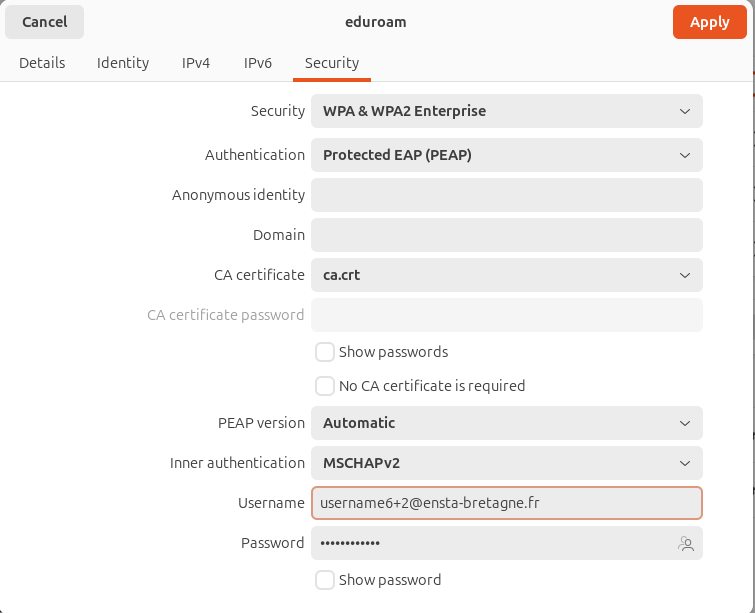

# How to connect to ENSTA printer: the example of N00 printer

[Lien ENSTA Connect qui détaille (parfois les images ne chargent pas)](https://enstafr.sharepoint.com/:u:/r/sites/ENSTACONNECT-DSI/SitePages/Wifi-eduroam---Linux.aspx?csf=1&web=1&e=CFI4dj)

- Download the certificate : [Link](https://download.ensta-bretagne.fr/ensta_connect/dsi/wifi/ca.crt)
- Open Wifi Settings,
- Click on Eduroam Settings
- Go to Security,
- Follow the screenshot below and give the downloaded certificate.

  <h3>Follow this screenshot</h3>
  

And you're done !