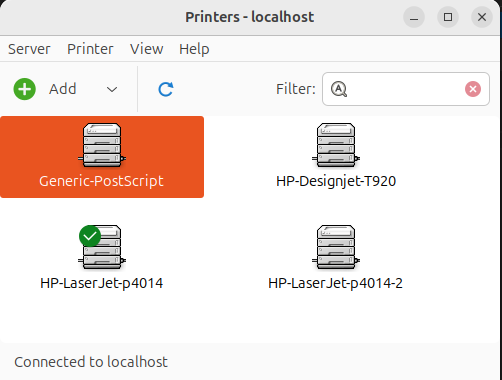
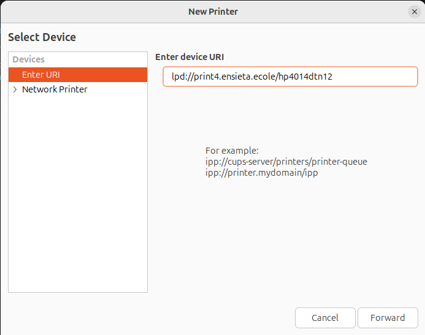
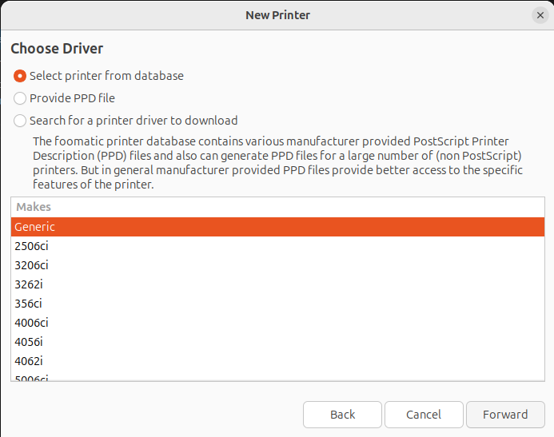
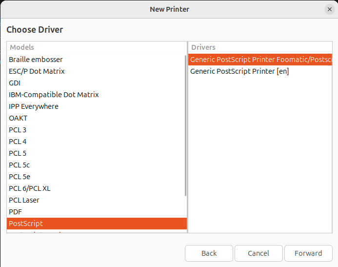
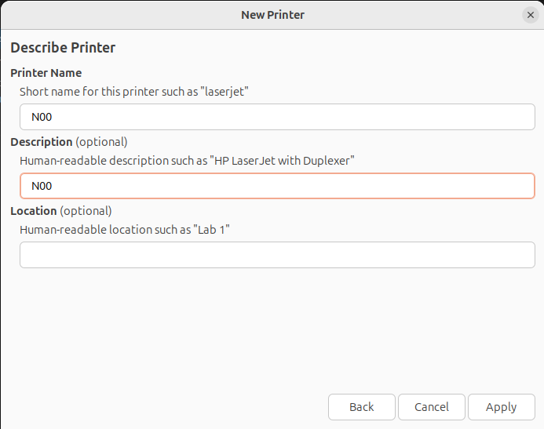

# How to connect to ENSTA printer: the example of N00 printer

>[!CAUTION]
>To make this tutorial work, you need to be connected to eduroam !

  <h3>Open Printer windows</h3>
  

  <h3>Enter the device name (can be found on the printer)</h3>
  

  <h3>Choose generic drivers ...</h3>
  

  <h3>and PostScript</h3>
  

  <h3>Finaly, change the name of the printer as you prefer !</h3>
  

And you're done !