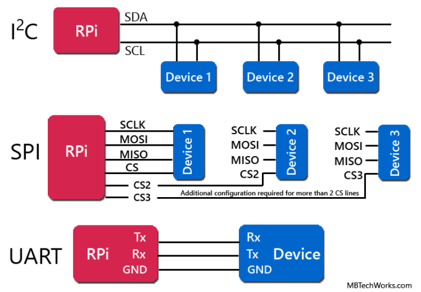
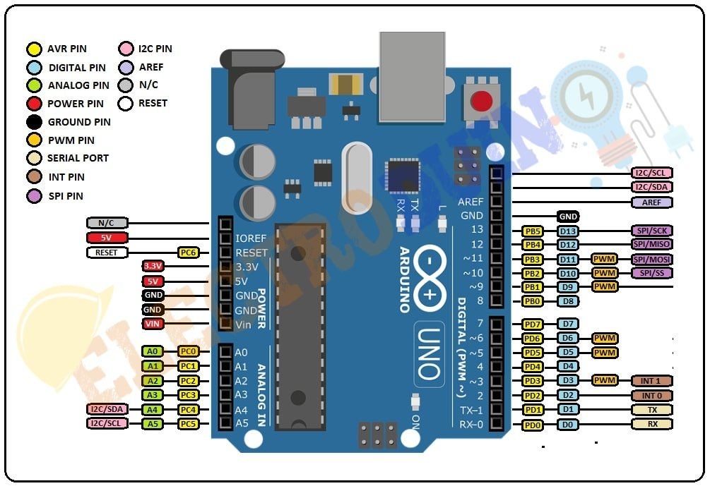
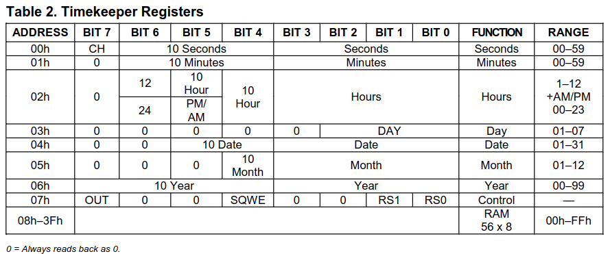

# Communication Interfaces


## Introduction

There are multiple interfaces to communicate with one or more devices, the most common are :
- UART: Universal Asynchronous Receiver/Transmitter
- SPI: Serial Peripheral Interface
- I2C: Inter-Integrated Circuit



There use cases are :
- UART: Debugging, basic serial communication
- SPI: Memory cards, displays, high-speed peripherals
- I2C: Sensors, real-time clocks, EEPROMs

## TODO

We'll use the website [Wokwi](wokwi.com) to simulate an Arduino. It is free to use and has many components to choose from.
**Instructions with a ⭐ requires a screenshot to validate this workshop.**

### I2C

-  Start a project from scratch with an Arduino Uno
-  Add the following three components and connect them to the Arduino :
    -  DS1307, RTC Module
    -  MPU6050, 6-Axis Accel & Gyro Sensor
    -  BMP180, Barometric Pressure Sensor

    > The I2C pins can be found on the Arduino Uno Pinout :
    >
    > 

-  Run a script to discover the addresses of the three components

    > Each component has a fixed address that can be found on their datasheet. But another method is to scan all addresses to find the connected devices.
    ><details>
    ><summary>[REVEAL CODE] Device scan</summary>
    >
    >```
    >#include <Wire.h>
    >
    >void setup() {
    >Serial.begin(9600);
    >Wire.begin();
    >
    >for (byte adresse = 1; adresse < 127; adresse++) {
    >
    >    Wire.beginTransmission(adresse);
    >
    >    byte erreur = Wire.endTransmission();
    >
    >    if (erreur == 0) {
    >    Serial.print("Peripherique trouve : 0x");
    >    Serial.println(adresse, HEX);
    >    }
    >}
    >}
    >
    >void loop() {
    >}
    >```
    >
    ></details>

    > Two devices cannot have the same address on the same bus. Unfortunately, both DS1307 and MPU6050 have the same one. Fortunately, the MPU6050 allows you to change its address whether AD0 is connected to GND or 5V.
    > 
    > Another solution is to use an I2C multiplexer such has the TCA9548A to connect more devices.

-  ⭐ Change the address of MPU6050 and check whether you get three different addresses

-  ⭐ Write a code to read and print the seconds from the DS1307 clock

    > Each I2C device has a register table, to read data from the device you need to ask it at the corresponding register adress.
    > 
    > For example here is the DS1307 register table from 0x00 to 0x07 :
    > 
    > 
    > The process to get data is :
    >- select device
    >- select register
    >- request a byte read
    >- read the byte
    > 
    > You can start from this example code and find the right register address :
    >
    > <details>
    > <summary>[REVEAL CODE] Read byte</summary>
    > 
    > ```
    > #include <Wire.h>
    > 
    > void setup() {
    > Serial.begin(9600);
    > Wire.begin();
    > }
    > 
    > void loop() {
    > 
    > // Select device and register
    > Wire.beginTransmission(0x68);
    > Wire.write(/*REGISTRE*/);   // A COMPLETER
    > Wire.endTransmission();
    > 
    > // Request a byte read
    > Wire.requestFrom(0x68, 1);
    > 
    > // Read the byte
    > if (Wire.available()) {
    > 
    >     byte seconds = Wire.read();
    > 
    >     // Convert BCD to décimal
    >     seconds = (seconds & 0x0F) + 10 * (seconds >> 4);
    > 
    >     Serial.print("Seconds : ");
    >     Serial.println(seconds);
    > }
    > 
    > delay(1000);
    > }
    > ```
    > 
    > </details>

### SPI

- Start a project from scratch with an Arduino Uno.
- Add a MAX7219 8x8 LED Matrix component.

  > The MAX7219 communicates with the Arduino using SPI.
  >
  > Unlike I2C, SPI does not use device addresses. Each device has a dedicated Chip Select (CS) pin.
  >
  > The SPI bus uses the following signals:
  >
  > - MOSI: Master Out, Slave In (data from Arduino to device)
  > - MISO: Master In, Slave Out (data from device to Arduino)
  > - SCK: Serial Clock
  > - CS: Chip Select (selects the device)
  >
  > The MAX7219 uses DIN, CLK and CS. It does not provide a standard MISO response in this example.

- Connect the MAX7219 to the Arduino:

  | MAX7219 | Arduino Uno |
  |---|---|
  | VCC | 5V |
  | GND | GND |
  | DIN | 11 (MOSI) |
  | CS | 10 (SS) |
  | CLK | 13 (SCK) |

- Write a program to send data to the MAX7219.

  > The SPI communication process is:
  >
  > - Configure the SPI interface.
  > - Select the device by setting CS LOW.
  > - Send the register address.
  > - Send the data byte.
  > - Deselect the device by setting CS HIGH.
  >
  > The MAX7219 uses a 16-bit frame: 8 bits for the register address followed by 8 bits of data.
  >
  > You can start from this example and complete the missing values:
  >
  > <details>
  > <summary>[REVEAL CODE] Send data over SPI</summary>
  >
  > ```cpp
  > #include <SPI.h>
  >
  > const int CS_PIN = 10;
  >
  > void writeRegister(byte address, byte data) {
  >   digitalWrite(CS_PIN, LOW);
  >
  >   SPI.transfer(address);
  >   SPI.transfer(data);
  >
  >   digitalWrite(CS_PIN, HIGH);
  > }
  >
  > void setup() {
  >   pinMode(CS_PIN, OUTPUT);
  >   digitalWrite(CS_PIN, HIGH);
  >
  >   SPI.begin();
  >
  >   // Configure MAX7219
  >   writeRegister(0x0F, 0x00); // Display test OFF
  >   writeRegister(0x0C, 0x01); // Normal operation
  >   writeRegister(0x0B, 0x07); // Scan all 8 digits
  >   writeRegister(0x09, 0x00); // No BCD decoding
  >   writeRegister(0x0A, 0x08); // Brightness
  >
  >   // Display a pattern on the first row
  >   writeRegister(/* REGISTER */, /* DATA */);
  > }
  >
  > void loop() {
  > }
  > ```
  >
  > </details>

- ⭐ Find the correct register address and data value to display a pattern on the LED matrix
    > The code ```writeRegister(0x01, 0b00011000)``` lights 2 LEDs, you can experiment from that
- ⭐ Add another MAX7219 and display the pattern on the second display using two CS pins