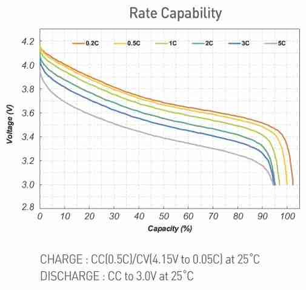
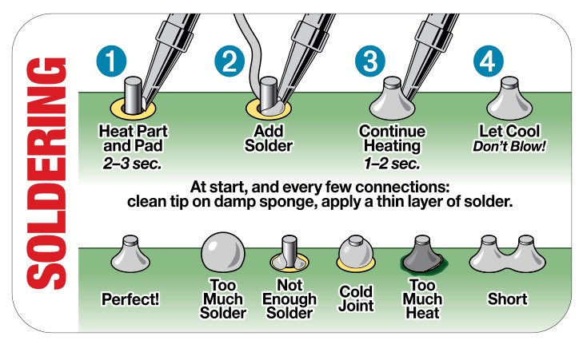
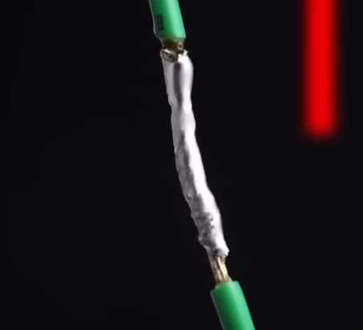
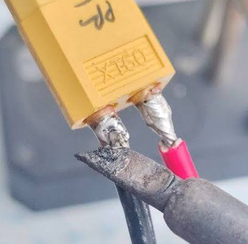
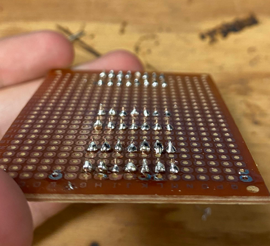

# Electrical workshop

## Battery

Battery and wire choice requires attention to avoid accidents.

The main battery technologies you will use are :
- Li-Po, Lithium Polymer, more current output
- Li-Ion, Lithium Ion, more durable, longer cycle life

Both technologies follow the same specifications :
- Capacity
    - in mAh
    - the higher the capacity the higher the current output
- Number of cells, in S (eg. 2S)
    - in S
    - 1S means one cell
    - proportional to the voltage, one cell has a nominal voltage of 3.7V, so a 2S is 7.4V
- Discharge rate
    - in C
    - Discharge rate x Capacity = Maximum current output (a 5000mAh 50C battery can output a maximum of 250A)
- Charge rate
    - in C
    - Charge rate x Capacity = Maximum charging current
    - Almost always equal to 1C (a 5000mAh should not be charged above 5A)

> [!CAUTION]
> Precautions :
> - Each cell voltage should stay between 3.0V and 4.2V
> - To enhance its lifespan, the battery should be recharged once it reaches 3.4-3.7V per cell
> - You should not draw more current than the maximum discharge rate
> - You should not charge with higher current than the maximum charging rate
> - If the battery is not used for a long time it should be charged in STORAGE mode to keep voltage between 3.7V and 3.85V

This curve shows the voltage drop happening at around 3.2-3.4V, you want to keep the voltage higher to avoid irreversible damage to the battery.

## Wire

Main things to understand about wire choice :
- A thicker wire has less resistance, so :
    - it can carry larger current without melting (P = R * I²)
    - it reduces the voltage drop, its length increases the voltage drop
- Thickness is often expressed in AWG, the lower the AWG the thicker the wire
- The precise maximum current a wire can hold depends on many factor (thickness, length, voltage, material, ambient temperature)

## TODO
> [!IMPORTANT]
> **There is no practical applications but to verify your understanding please answer these ⭐ questions :**
- ⭐ You have 3 batteries :
    - **a** 3000mAh, 6s, 40C
    - **b** 5000mAh, 2s, 30C
    - **c** 10000mAh, 1s, 10C
Which one have the highest current output ? ____
Which one have the highest capacity ? ____
Which one have the highest energy  ? ____
- ⭐ You have a 8000mAh, 4s, 50C battery.
what is its maximum voltage ? ____
at which voltage should you stop before recharging it ? ____
- ⭐ You power one sensor with 5V from an Arduino but the sensor does not work because it only gets 4V.
what can you do ? ______________________________________

## Soldering

For soldering you will need :
- Soldering iron, heated up to around 400°c
- Solder bobbin
- Fan, to avoid breathing soldering fumes

### Resources
[Short video to solder two wires together](https://www.youtube.com/shorts/2N6uXyUPfgA) (less than 1 min)
[Short video to solder pads](https://www.youtube.com/shorts/nPz37an_7ng) (less than 1 min)
[Adafruit guide to soldering](./adafruit-guide.pdf) (look up from page 12)
Soldering technique cheat sheet :

### TODO
> [!IMPORTANT]
> **Complete these three ⭐ tasks and take a picture as proof :**
- ⭐ Solder two wires together
- ⭐ Solder a XT60 connector
- ⭐ Solder pins to a copper breadboard

The main goal is to get everyone to practice soldering, the best tips is to practice but here are other useful ones :
- Use flux paste, it helps conducting the heat and make soldering easier
- Use ventilation
- Put the solder on the heated part and not on the iron
- Put a bit of solder on the tip of the iron to help conducting the heat

|  |  |  |
| ------ | ------ | ------ |