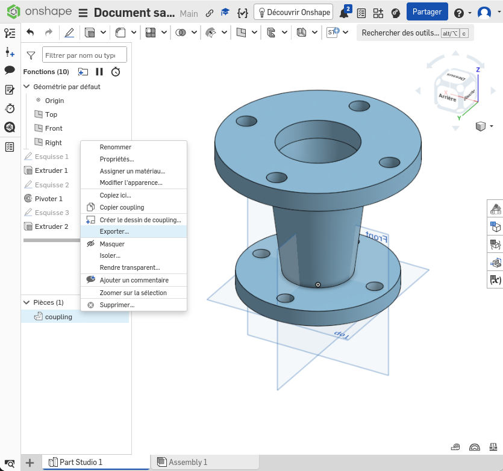
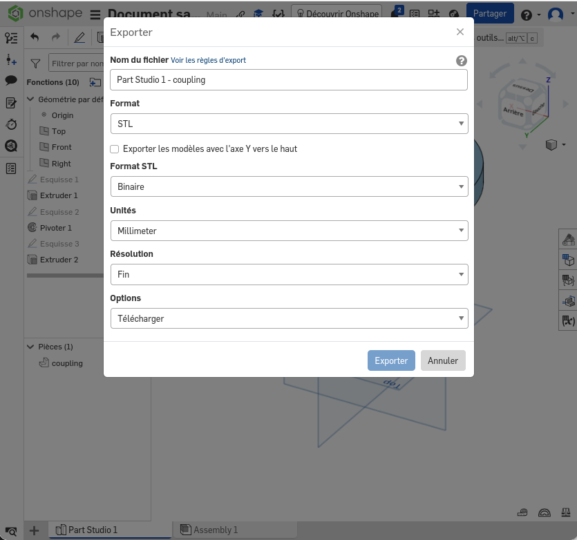
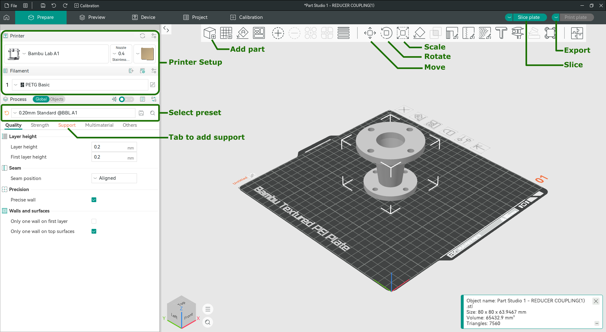

# Mechanical design, CAD & 3D Printing

## CAD (Computer Aided Design)

**Objectif:** Get to know the useful features of a CAD software.

### Tools
CAD software for mechanical design are parametric, the design process relies on constrained sketches and volumetric operations. Some commonly used software are :

- [Onshape](https://www.onshape.com/)
    - free student license
    - online
    - easy to learn
- [FreeCAD](https://www.freecad.org/downloads.php)
    - open source free license
    - Windows, Mac, Linux
    - slighly trickier to learn
- [Autodesk Fusion](https://www.autodesk.com/education/edu-software/overview)
    - free student license
    - Windows, Mac
    - easy to learn  

### TODO

For this workshop, we'll use Onshape. It has a learning course with exercises that showcase the useful feature for mechanical design. [Sign in](https://www.onshape.com/en/education/sign-up) with your @ensta.fr email address to access the free student license.
> [!IMPORTANT]
> **You'll have to complete the exercise of the [Onshape learning course](https://learn.onshape.com/learn/learning-path/introduction-to-cad), exercises with a ⭐ are required to validate this workshop, take a screenshot at the end as proof :**
- Introduction to Sketching
    - ⭐ [Exercise: Basic Sketching](https://learn.onshape.com/learn/course/fundamentals-sketching/sketch-constraints/exercise-basic-sketching?page=1)
    - ⭐ [Exercise: Intermediate Skectching](https://learn.onshape.com/learn/course/fundamentals-sketching/sketch-tools/exercise-intermediate-sketching?page=1)
- Introduction to Part Studios
    - ⭐ [Exercise: Control Arm](https://learn.onshape.com/learn/course/introduction-to-part-studios/basic-features/exercise-control-arm?page=1)
    - ⭐ [Exercise: Reducer Coupling](https://learn.onshape.com/learn/course/introduction-to-part-studios/basic-features/exercise-reducer-coupling?page=1)
    - [Exercise: Jackhammer Gear Cover](https://learn.onshape.com/learn/course/introduction-to-part-studios/applied-features/exercise-jackhammer-gear-cover?page=1)
    - [Exercise: Funnel](https://learn.onshape.com/learn/course/introduction-to-part-studios/advanced-features/exercise-funnel?page=1)
    - [Exercise: Rocket Guidance Reflector](https://learn.onshape.com/learn/course/introduction-to-part-studios/patterning/exercise-rocket-guidance-reflector?page=1)
- Introduction to Onshape Assemblies
    - ⭐ [Exercise: Start an Assembly](https://learn.onshape.com/learn/course/introduction-to-onshape-assemblies/creating-an-assembly/exercise-start-an-assembly?page=1)
    - ⭐ [Exercise: Pneumatic Assembly](https://learn.onshape.com/learn/course/introduction-to-onshape-assemblies/mating-assembly-instances/exercise-pneumatic-cylinder?page=1)
    - [Exercise: Assembly Structure](https://learn.onshape.com/learn/course/introduction-to-onshape-assemblies/working-with-an-assembly/exercise-assembly-structure?page=1)
    - [Exercise: Creating Explicit Mate Connectors](https://learn.onshape.com/learn/course/introduction-to-onshape-assemblies/explicit-mate-connectors/exercise-creating-explicit-mate-connectors?page=1)

## 3D Printing 

**Objectif:** Get to know the 3D printing process with a FDM printer.

### Tools

The available printers are Bambulab A1, we recommend the software [OrcaSlicer](https://www.orcaslicer.com/download/) available for Windows, Mac et Linux.

### TODO
> [!IMPORTANT]
> **⭐ Print the previously design part**

- Reopen the part "Reducer Coupling"
- Export the part in .STL format in mm

  |  
:-------------------------:|:-------------------------:

- Open OrcaSlicer and set it up:
    - Install network plugin
    - Activate Stealth Mode
    - Select Bambulab A1
    - Select Bambulab filaments
    - Select nozzle size (0.4)
    - Select Textured PEI Plate
- Add the part to the plate
- Scale it to reach 30mm of height
- Add supports (tree)
- Exporte the palte sliced file in .gcode.3mf
- Transfer the file onto the printer sd card
- Print

> Tips and tricks :
>- Always check on the first layers, if the first layers does not stick and the printer is not stopped it could damage the printer.
>- If the first layer does not stick, wash the plate with soap and water and try again. Do not use glue or hairspray.
>- Try to design and rotate the part to reduce the need of supports.
>- Move the part around the plate each print to avoid wearing only the center of the plate.