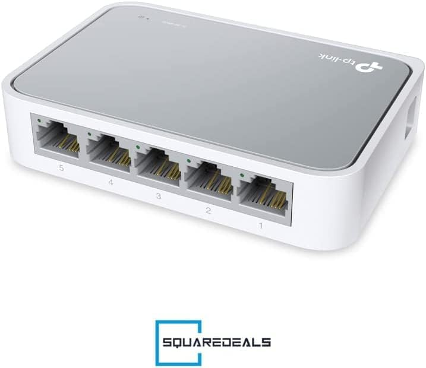
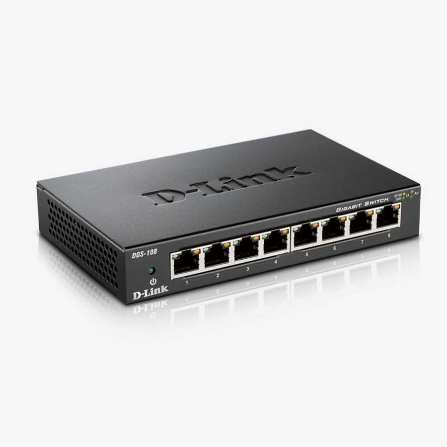
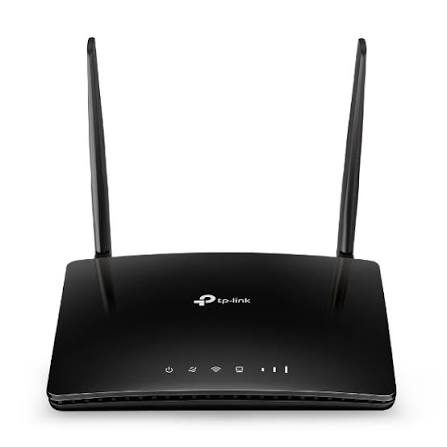
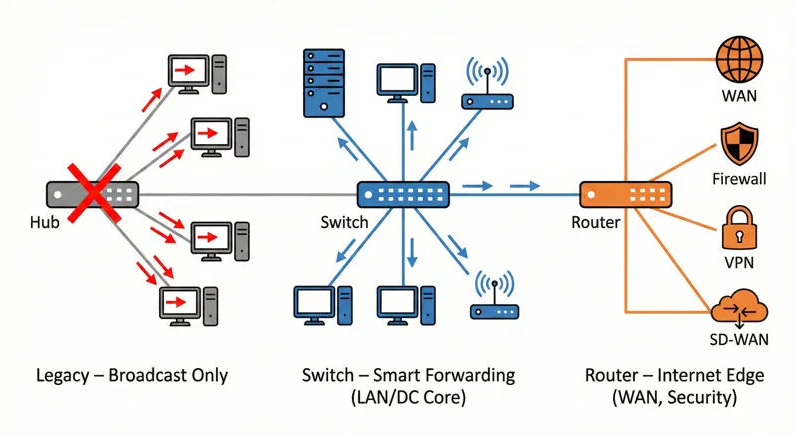

# 1. Architecture réseau
> [!NOTE]
> **Durée : 20 minutes**

## 1.1. Les principaux composants

Un réseau informatique est constitué de différents équipements permettant de connecter des machines et d'échanger des données.

### Hub (concentrateur)

Un hub est un équipement réseau qui reçoit des données sur un port et les retransmet sur tous les autres ports.

Il ne fait aucune distinction entre les destinataires des messages.

  

### Switch (commutateur)

Un switch permet de connecter plusieurs équipements sur un même réseau local.

Contrairement au hub, il apprend les adresses MAC des équipements connectés et transmet les trames vers le port correspondant au destinataire.

  

### Routeur

Un routeur permet de faire communiquer plusieurs réseaux IP différents.

Il utilise notamment les adresses IP et sa table de routage pour déterminer vers quel réseau transmettre les paquets.

  

### En plus : Serveur

Un serveur est une machine qui fournit un service à d'autres équipements appelés clients.

Exemples :
- Serveur de stockage.
- Serveur web.
- Serveur DHCP.
- Serveur DNS.
- Serveur de supervision robotique.

Un serveur n'est pas nécessairement un équipement réseau dédié : il peut simplement s'agir d'un ordinateur exécutant un logiciel serveur.

## 1.2. Comparaison

| Équipement | Fonction principale |
|---|---|
| Hub | Répéter les données vers tous les ports |
| Switch | Connecter les équipements d'un réseau local |
| Routeur | Connecter plusieurs réseaux IP |
| Serveur | Fournir un service aux autres machines |

  

> [!CAUTION]
> 
> ## 1.3. Exercice — Concevoir un réseau robotique

> ### Mise en situation

> Une équipe développe un système de robotique mobile composé de :
> - Deux robots autonomes.
> - Un ordinateur de supervision.
> - Un serveur de stockage.

> Les robots et l'ordinateur doivent pouvoir communiquer entre eux. Le serveur doit également être accessible depuis les trois autres machines.

> Enfin, l'ensemble du système doit pouvoir accéder à Internet.

> ### Travail demandé

> - ⭐ 1. Dessiner une architecture réseau permettant de connecter les quatre machines.
> - ⭐ 2. Identifier les équipements réseau nécessaires.
> - ⭐ 3. Indiquer quel composant doit être placé entre chaque liaison.
> - ⭐ 4. Expliquer le rôle de chaque équipement.

**Schéma de principe :**

