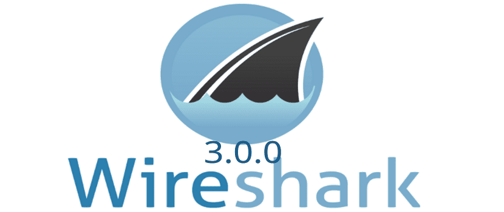
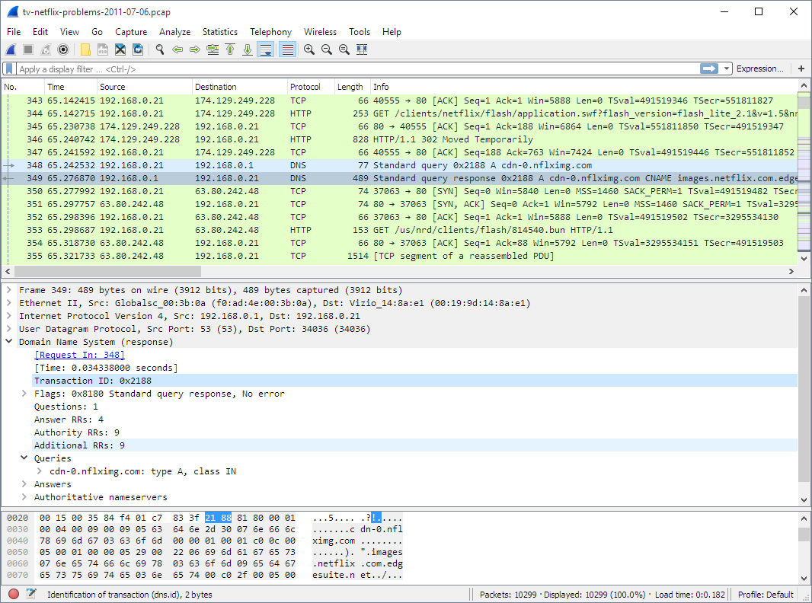
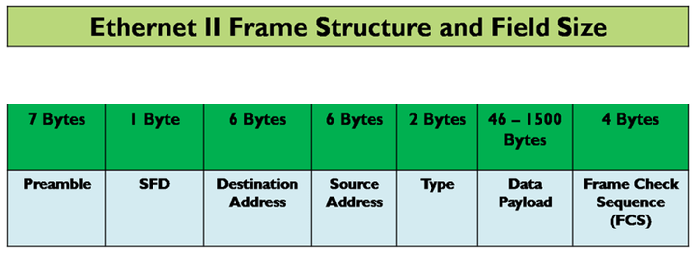

# 4. Analyse réseau avec Wireshark

> [!NOTE]
> **Durée : 20 minutes**

<div align="center">
  <h3>Wireshark</h3>
  
</div>

## 4.1. Présentation

Wireshark est un logiciel permettant de capturer et d'analyser les paquets échangés sur un réseau.

Il est particulièrement utile pour :
- Comprendre les échanges entre deux machines.
- Identifier les protocoles utilisés.
- Diagnostiquer des problèmes réseau.
- Observer les communications TCP, UDP, DNS, ICMP, etc.

Installation :

```bash
sudo apt install wireshark
```

## 4.2. Les trois zones principales

L'interface de Wireshark est composée de trois zones :

1. **Packet List** : liste des paquets capturés.
2. **Packet Details** : détails du paquet sélectionné et de ses différentes couches protocolaires.
3. **Packet Bytes** : représentation des données brutes en hexadécimal et ASCII.

<div align="center">
  <h3>Interface Wireshark</h3>
  
</div>

## 4.3. Réaliser une capture

1. Ouvrir Wireshark.
2. Sélectionner l'interface réseau utilisée.
3. Démarrer la capture.
4. Générer du trafic réseau en lançant les scripts Python précédents.
5. Arrêter la capture.

Pour observer une communication locale entre deux programmes utilisant `127.0.0.1`, sélectionner l'interface `lo` (loopback).

## 4.4. Les filtres d'affichage

Wireshark propose des filtres permettant de sélectionner les paquets qui nous intéressent.

| Filtre | Fonction |
|---|---|
| `tcp` | Afficher les paquets TCP |
| `udp` | Afficher les paquets UDP |
| `icmp` | Afficher les paquets ICMP |
| `dns` | Afficher les requêtes DNS |
| `ip.addr == 192.168.1.10` | Filtrer une adresse IP |
| `tcp.port == 5000` | Filtrer un port TCP |
| `udp.port == 5001` | Filtrer un port UDP |

## 4.5. Analyser une trame

Sélectionner une trame TCP ou UDP et observer les différents niveaux d'encapsulation.
<div align="center">
  <h3>Exemple de décomposition d'une trame réseau</h3>
  
</div>

Les principales informations à identifier sont :

- **Ethernet** : adresses MAC source et destination.
- **IPv4** : adresses IP source et destination.
- **TCP / UDP** : ports source et destination.
- **Application** : données transmises.

> [!CAUTION]
> ## 4.6. Questions
> - ⭐ 1. Quelle est l'adresse IP source ?
> - ⭐ 2. Quelle est l'adresse IP destination ?
> - ⭐ 3. Quel est le port source ?
> - ⭐ 4. Quel est le port destination ?
> - ⭐ 5. Quelle différence observez-vous entre une trame TCP et une trame UDP ?
> - ⭐ 6. Peut-on retrouver le contenu du message envoyé par le client Python ?
