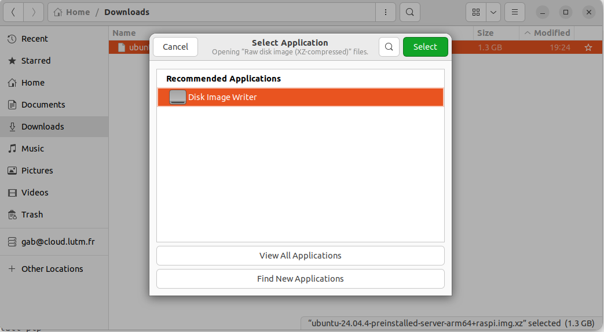
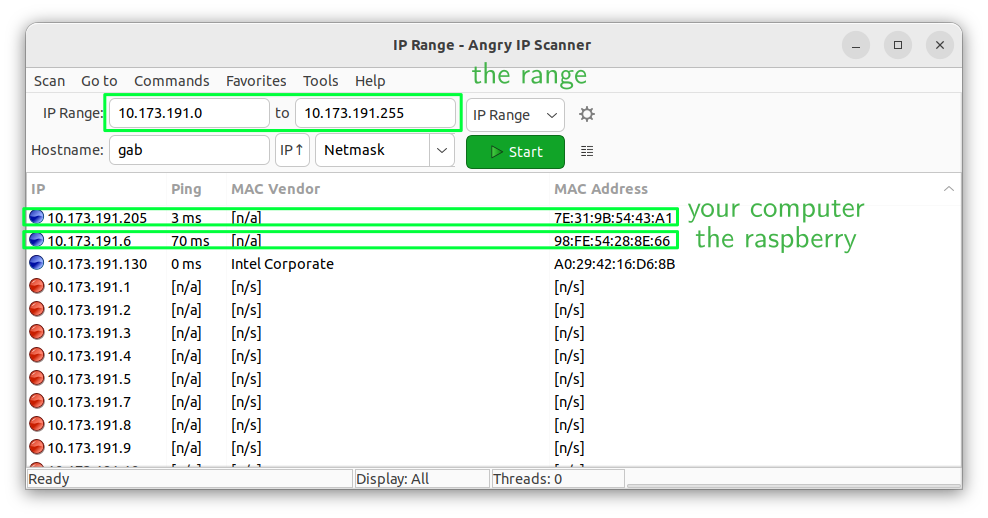

# Raspberry Pi setup

This is an attempt to make a simple walkthrough to a functional Raspberry for any robotic project

## Requirements
- Raspberry Pi 4
- Micro SD card
- Micro SD card reader
- Compatible power supply

## Image download

The Raspberry Pi 4 has an aarch64 architecture, Ubuntu realeases preinstalled image for raspberry. You can download the image from [here](https://cdimage.ubuntu.com/ubuntu/releases/24.04/release/ubuntu-24.04.4-preinstalled-server-arm64+raspi.img.xz).

## Image flash

The SD card is the only disk of the Raspberry, there is no internal storage. 
- Using a micro SD card reader, plug the micro SD card in your computer.
- Right-click on the .img.xz file and open with the built-in Disk Image Writer.
- Select the storage corresponding to the micro SD card and confirm.
    > [!CAUTION]
    > Do not write on your computer storage.



## First boot setup

- Keep the micro SD card plugged in your computer, and open `system-boot`.
- Edit the file `network-config` :
    ```
    wifis:
    wlan0:
      optional: true
      access-points:
        "SSID":
          password: "MDP"
      dhcp4: true
      regulatory-domain: FR
    ```
    > [!NOTE]
    > Set SSID and MDP of an accessible network. Using your phone access point can be simpler for the next steps.
    >
    > The content of this file will set a .yaml file in /etc/netplan/.

    > [!CAUTION]
    > Take care to only use spaces for indentation
- Edit the file `user-data` and set :
    ```
    ssh_pwauth: true
    ```
    > [!NOTE]
    > It allows you to connect to the raspberry using SSH

- Insert the micro SD card in the Raspberry and power it on.

## SSH connection

- Connect your computer to the same network you set for the Raspberry.
- Find your Raspberry Pi address on the network. A useful tool I recommend is [Angry IP Scanner](https://angryip.org/).
  - Start the software
  - If your IP address is 192.168.10.50 you want to scan from 192.168.10.0 to 192.168.10.255
  - In the setting select Ping, MAC Vendor and MAC Address
  - Start the scan
  - Find your Raspberry, usually their MAC Address start with `DC:A6:32` or `E4:5F:01` or `D8:3A:DD` or `88:A2:9E`
  
- Connect via SSH to your Raspberry `ssh ubuntu@<IP>`
  > [!NOTE]
  > Using this image, the password is ubuntu. On the first connection you will be asked to change password.

## Setup

- Change password
  > If not already done, use the `passwd` command
- Change hostname
  - ```sudo hostnamectl set-hostname <new_hostname>```
  - Edit /etc/hosts and replace the old hostname with your new hostname on the 127.0.1.1 line.
  - Save and exit.
  > [!NOTE]
  > The hostname is the name used to identify your Raspberry on the local network. You can use it instead of its IP address when connecting through SSH `ssh ubuntu@new_hostname`.
> [!CAUTION]
> Carefully write username, hostname and password to avoid losing access to your Raspberry.

## Validation
> [!IMPORTANT]
> - ⭐ Take a screenshot of your computer screen showing the ssh connection to the raspberry and its output
