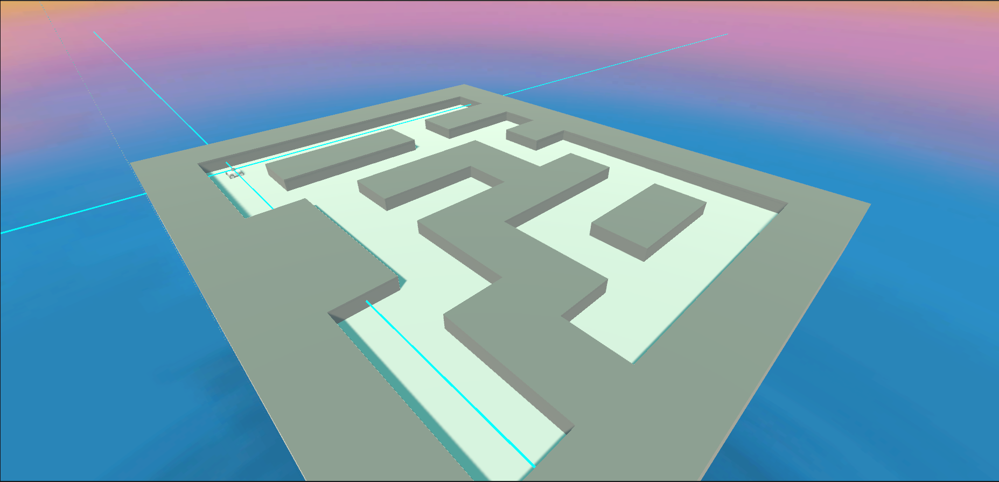

# TP — Prise en main de ROS 2 avec Mino

> [!NOTE]
> **Durée : 1 h 30 à 2 h**
>
> **Environnement : Ubuntu 24.04 / ROS 2 Jazzy / Python 3**
>
> **Objectif :** mettre en pratique les compétences ROS 2 et Python à travers le contrôle d'un robot mobile dans un environnement ludique.

## 1. Présentation du projet

Dans ce TP, vous allez prendre le contrôle de **Mino**, un robot mobile évoluant dans un labyrinthe simulé sous Unity.

L'objectif est de manipuler ROS 2 pour récupérer les données des capteurs, visualiser les informations du robot et lui envoyer des commandes de déplacement.



**Projet et téléchargement :**
- [Télécharger la simulation Linux](https://github.com/tbelier/mino-unity-ros2/releases/tag/Linux-x86_64)

## 2. Préparation

Lancer la simulation Unity et démarrer les nodes ROS 2 nécessaires à son fonctionnement.

Vérifier que ROS 2 est correctement configuré :

```bash
printenv ROS_DISTRO
```

La distribution attendue est `jazzy`.

## 3. Exploration du système ROS 2

> [!NOTE]
> Avant de programmer, il est important de savoir identifier les nodes, les topics et les types de messages utilisés par un système ROS 2 existant.

### Exercice 1 — Architecture ROS 2

1. Lister les nodes actifs avec `ros2 node list`.
2. Identifier les topics disponibles avec `ros2 topic list`.
3. Afficher les informations d'un node avec `ros2 node info /nom_du_node`.
4. Visualiser l'architecture complète avec `rqt_graph`.

⭐ **Question :** fournir le graphe ROS 2 et identifier les principaux nodes ainsi que leurs communications.

### Exercice 2 — Identifier les interfaces

Pour chaque topic intéressant, utiliser :

```bash
ros2 topic info /nom_du_topic
```

Cette commande permet notamment de connaître le type de message utilisé.

Pour afficher la structure d'un message :

```bash
ros2 interface show nom_du_type
```

⭐ **Question :** réaliser un tableau récapitulatif des principaux topics, de leurs types de messages et de leur fonction.

## 4. Récupération et exploitation des données capteurs

> [!NOTE]
> En ROS 2, un node peut s'abonner à un topic pour recevoir les messages publiés par un autre node.
>
> En Python, cette opération est réalisée avec un *subscriber*.

### Exercice 3 — Récupérer les données des capteurs

1. Identifier les topics contenant les données des capteurs.
2. Récupérer les mesures des différents LiDAR.
3. Identifier et récupérer les données de l'IMU.
4. Récupérer les données de vitesse du robot.
5. Identifier les grandeurs physiques contenues dans les messages.

Vous pourrez utiliser les commandes suivantes pour explorer les données :

```bash
ros2 topic echo /nom_du_topic
ros2 topic info /nom_du_topic
```

⭐ **Question :** identifier les topics, les types de messages et les principales grandeurs physiques transmises par les capteurs.

⭐ **Bonus :** réaliser un node Python qui s'abonne à un topic capteur et affiche les données reçues dans le terminal.

## 5. Visualisation des données

### Exercice 4 — Visualisation avec PlotJuggler

PlotJuggler permet de visualiser des données temporelles sous forme de courbes.

Lancer l'application :

```bash
ros2 run plotjuggler plotjuggler
```

1. Connecter PlotJuggler à ROS 2.
2. Récupérer les données de l'IMU.
3. Afficher les différentes composantes de l'accélération et de la vitesse angulaire.
4. Ajouter les données de vitesse du robot.
5. Déplacer le robot dans Unity et observer l'évolution des courbes.

⭐ **Question :** fournir une capture d'écran de PlotJuggler et expliquer l'évolution des mesures pendant un déplacement.

### Exercice 5 — Visualisation caméra avec RViz2

Les caméras permettent de récupérer des images de l'environnement observé par le robot.

1. Identifier le topic contenant les images de la caméra.
2. Identifier son type de message.
3. Lancer RViz2 :

```bash
rviz2
```

4. Ajouter un affichage de type **Image**.
5. Sélectionner le topic de la caméra.
6. Vérifier que les images sont correctement reçues.

⭐ **Question :** fournir une capture d'écran de RViz2 affichant les images de la caméra.

## 6. Contrôle du robot

> [!NOTE]
> Pour envoyer des commandes à un robot ROS 2, un node peut publier des messages sur un topic auquel le contrôleur du robot est abonné.
>
> En Python, cette opération est réalisée avec un *publisher*.

### Exercice 6 — Envoyer des commandes moteur

1. Identifier le topic utilisé pour commander le robot.
2. Identifier le type de message attendu.
3. Examiner la structure du message avec `ros2 interface show`.
4. Envoyer une commande de déplacement depuis le terminal.
5. Faire varier les valeurs pour modifier la trajectoire du robot.

Pour Mino, le topic de commande est :

```bash
/mino/control/u
```

Il utilise le type de message `geometry_msgs/msg/Twist`.

Exemple : avancer à une vitesse linéaire de 0,1 m/s :

```bash
ros2 topic pub --once /mino/control/u geometry_msgs/msg/Twist \
"{linear: {x: 0.1}, angular: {z: 0.0}}"
```

Pour arrêter le robot :

```bash
ros2 topic pub --once /mino/control/u geometry_msgs/msg/Twist \
"{linear: {x: 0.0}, angular: {z: 0.0}}"
```

⭐ **Question :** expliquer le rôle des composantes linéaires et angulaires du message `Twist`.

⭐ **Bonus :** réaliser un node Python permettant de commander le robot à l'aide d'un publisher ROS 2.

## 7. Pour aller plus loin — Contrôle autonome

L'objectif final est de réutiliser les notions abordées pendant ce TP pour créer un comportement autonome simple.

**Défi :** programmer un node Python capable de faire avancer Mino dans le labyrinthe en utilisant les données de ses capteurs LiDAR.

Le robot devra être capable de :
- Récupérer les mesures des capteurs.
- Détecter la présence d'un obstacle.
- Adapter sa vitesse et sa direction.
- Éviter les collisions avec les murs.

Vous êtes libres de proposer votre propre stratégie de navigation !
